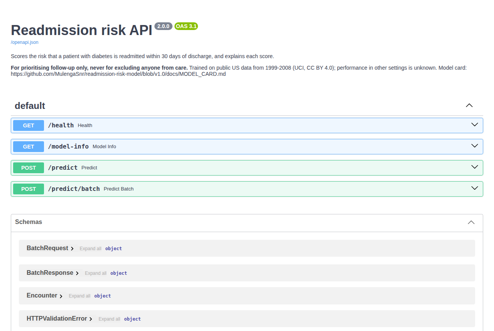
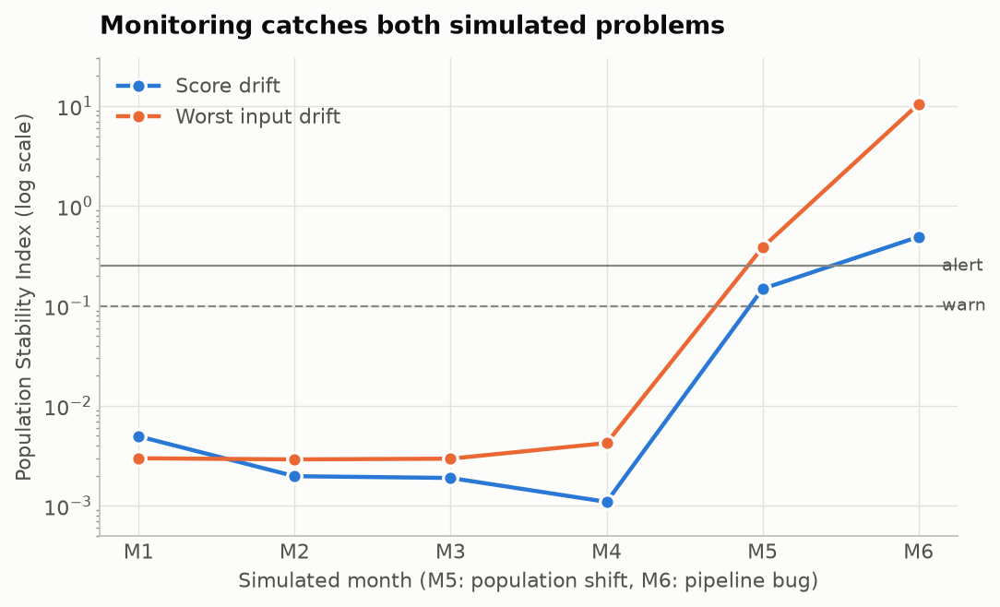

# Readmission Risk Model in Production

Taking a validated healthcare model from a laptop to a versioned, tested, monitored service: MLflow, FastAPI, Docker, GitHub Actions and Azure.


**Status:** Complete as a portfolio project and deployed. No real users depend on it, and it is not for clinical use.

**Live demo:** [interactive API docs](https://ca-readmission-api.purplemushroom-33c1d15b.francecentral.azurecontainerapps.io/docs). The app scales to zero when idle, so the first request takes a few seconds. Please do not enter real patient details.

## At a glance
| | |
|---|---|
| **Problem** | A validated readmission model is no use on a laptop. A care team needs a service that scores a discharge, explains the score, traces it to its model and warns when something drifts. |
| **Data** | UCI Diabetes 130-US Hospitals 1999–2008 (public, de-identified, CC BY 4.0). Production traffic is simulated. |
| **Approach** | Tracked training with promotion checks, an explained API, a tested container, CI that retrains and deploys on every merge, and monitoring with thresholds fixed in advance |
| **Result** | Test PR-AUC **0.231** against a no-skill 0.114; the top 20% of discharges reaches **37.9%** of readmissions. Live predictions take about **90 ms**. The monitoring caught **both** problems planted in a six-month simulation, with no false alarms in the normal months. |
| **Stack** | Python 3.12, XGBoost, MLflow, FastAPI, Docker, GitHub Actions, GHCR, Azure Container Apps, OIDC, uv, pytest |



Documents: [Model card](docs/MODEL_CARD.md) · [Runbook](docs/RUNBOOK.md) · [Design and decisions](docs/DESIGN.md) · [Findings for non-technical readers](reports/findings.md)

## The problem
[`readmission-risk-model`](https://github.com/MulengaSnr/readmission-risk-model) built a calibrated, explained and fairness-audited model that predicts 30-day readmission for patients with diabetes. A model on a laptop helps no one. A care team needs a service that scores a discharge on request, explains the score, can be traced to the exact model that produced it, and warns when something drifts. This project shows the difference between **developing** a model and **operating** one.

## Architecture
```
 merge to main ──► GitHub Actions: tests ──► container test ──► retrain + promotion checks
                                                                     │
                     image in GitHub Container Registry ◄────────────┘
                                     │ OIDC login, no stored cloud credentials
                                     ▼
 Azure Container Apps: FastAPI + model ──► live smoke test

 replay (6 simulated months) ──► prediction log ──► monitoring: drift, calibration, recall by group
```
Full design, decisions and alert thresholds: [docs/DESIGN.md](docs/DESIGN.md).

## Model v2: training, tracking and registry
`make train` builds one pipeline (project 1's feature engineering → preprocessing **without payer** → XGBoost with project 1's tuned settings). It scores the pipeline with 5-fold patient-grouped cross-validation on the same folds as project 1, refits it on the full training set and scores the test set. It then logs everything to MLflow (parameters, metrics, per-fold results, data fingerprints, code versions) and registers the model. The `champion` alias moves only if the model passes the promotion checks in `configs/default.yaml`.

| | Cross-validation PR-AUC | Test PR-AUC | Test ROC-AUC | Readmissions reached, top 20% |
|---|---:|---:|---:|---:|
| v1.0 (project 1, with payer) | 0.234 ± 0.015 | 0.235 | 0.672 | 38.5% |
| **v2 (this project, no payer)** | **0.230 ± 0.014** | **0.231** | **0.670** | **37.9%** |

- **The v2 test score is a second use of the test set.** v1.0 was evaluated on it first. The score is used only to check v2 against v1.0, against a limit fixed in advance (no more than 0.01 PR-AUC below v1.0), not to choose between options. v2 is 0.003 lower and passed.
- **The cross-validation score reproduces project 1:** 0.2335 − 0.0037 = 0.2298, as found by project 1's payer analysis.
- **Safe model files:** models are saved with skops, not pickle. When the service loads a model, it accepts only the object types listed in [`serialization.py`](src/readmission_mlops/models/serialization.py), held in our code rather than in the model file (design decision D11).
- `make export` writes the champion to `artifacts/model/` (`model.skops` + `metadata.json`) for the service image. `make mlflow-ui` lets you browse runs and the registry.

## Prediction API
`make serve` starts a FastAPI service on the exported champion model. Interactive documentation is at `/docs`.

| Endpoint | Returns |
|---|---|
| `POST /predict` | Probability of 30-day readmission, risk band, the **top 3 reasons** (exact TreeSHAP) and warnings |
| `POST /predict/batch` | The same for up to 1,000 encounters (used by the replay) |
| `GET /health` | Whether a model is loaded, and its version |
| `GET /model-info` | Model version, MLflow run, data fingerprint, code versions, band cut-offs, offline metrics |

Example response for an 80–90-year-old with 4 inpatient stays in the previous year:
```json
{"probability": 0.3634, "risk_band": "highest 10%",
 "reasons": [{"label": "Inpatient stays, previous year", "value": "4", "effect": "raises risk", "shap_log_odds": 0.665},
             {"label": "Additional diagnosis group", "value": "Genitourinary (584)", "effect": "raises risk", "shap_log_odds": 0.143},
             {"label": "Secondary diagnosis group", "value": "Diabetes (250.02)", "effect": "raises risk", "shap_log_odds": 0.128}],
 "warnings": [], "request_id": "c2189cb9-…", "model_version": "2"}
```

- **Input validation:** closed categories (sex, age band, test results, medication status) must be known values, so a typo returns 422 instead of a silent guess. Open categories (admission type and source, discharge destination, specialty) accept new values with a warning. Diagnosis codes must be valid ICD-9. Length of stay must be 1–14 days, the training population. **Unknown fields are rejected, so identifiers can never be sent or logged.**
- **Risk bands** use cut-offs from out-of-fold training predictions (highest 10%: risk ≥ 19.7%; top 20%: ≥ 15.2%). On the test set they flag 10.1% and 19.9% of encounters.
- **Prediction log:** one JSON line per prediction (time, request ID, model version, inputs, score) feeds monitoring.
- **Speed:** a median of 91 ms per explained prediction against the live service (10 calls). One cold start from zero took 6 seconds.

## Container and CI/CD
**Image** ([Dockerfile](Dockerfile)): a two-stage build. uv installs the locked runtime dependencies only (no MLflow, no test tools), and the slim runtime image holds the environment, the code and the model.
- Base images are **pinned by digest**, so rebuilds are reproducible.
- Runs as a **non-root** user, with a Docker `HEALTHCHECK`. `/health` returns 503 when no model is loaded, so a broken container is marked unhealthy.
- **850 MB**, down from 1.08 GB, by leaving out pyarrow (170 MB), which only reads parquet. Predictions on 500 real test encounters are **identical** with and without it.

**Pipeline** ([ci.yml](.github/workflows/ci.yml)):

| Job | When | What |
|---|---|---|
| `lint-and-test` | Every PR and push | ruff + pytest |
| `container` | Every PR and push | Builds the image around a tiny **synthetic** model, runs it and smoke-tests it: health, model info, prediction, identifier and typo rejection, non-root, Docker health check |
| `release` | Merges to `main` | Downloads the data (cached, re-verified by SHA-256), **retrains the real model**, fails the build if the promotion checks fail, exports it, builds and smoke-tests the image, and pushes it to GitHub Container Registry as `sha-<commit>` and `latest` |
| `deploy` | Merges to `main`, after `release` | Logs in to Azure with OIDC, rolls out that exact image and smoke-tests the live URL |

Training is deterministic, so CI rebuilds the model validated locally from code and data. The live service's metrics, risk cut-offs and data fingerprint match the local model, and every image can be traced to a commit, a data checksum and passed promotion checks.

## Deployment
Azure Container Apps on the Consumption plan, in France Central, with the app capped at 0.5 vCPU, 1 GiB and one copy.

- **No cloud credentials in GitHub.** Actions logs in through OIDC to a managed identity that can only be used from `main` of this repo and can only change this resource group.
- **Designed for £0.** It scales to zero when idle and is expected to stay within the monthly free grant, with a spending limit on the subscription and a budget alert. The cost has not yet been confirmed against a billing period.
- **Trade-offs accepted for a demo:** no API key, no stored logs, cold starts and one copy. The reasons are in the [design decisions](docs/DESIGN.md#6-decisions), and day-to-day operation is in the [runbook](docs/RUNBOOK.md).

## Monitoring
Every prediction is logged. A monitoring job joins the log with outcomes (which arrive 30 days later) and compares each month with a **reference profile** saved with the model: out-of-fold score distribution, input distributions, missing rates and recall at the fixed top-20% cut-off. Checks are graded OK / WARN / ALERT against thresholds fixed in [DESIGN.md](docs/DESIGN.md#7-monitoring-thresholds-initial) before any data was seen.

**Simulation** (`make replay`, then `make monitor`): six months through the real API. Months 1–4 are the held-out test set in four parts; month 5 is a **population shift** (older patients with more prior stays); month 6 is a **pipeline bug** (discharge destination arrives empty).



| Month | Scenario | Status | Score PSI | Worst input PSI | Missing ↑ (pts) | Calibration (pts) | Recall drop (pts) | Age 80+ gap (pts) |
|---|---|---|---:|---:|---:|---:|---:|---:|
| 1–2 | normal | OK | ≤ 0.005 | ≤ 0.003 | ≤ 0.12 | n/a | n/a | n/a |
| 3 | normal | OK | 0.002 | 0.003 | 0.79 | 1.88 | 2.08 | 2.78 |
| 4 | normal | OK | 0.001 | 0.004 | 0.32 | 1.26 | 0.49 | 1.00 |
| 5 | population shift | **ALERT** | 0.15 WARN | **0.39 ALERT** (age) | 0.00 | 1.65 | −5.71 | −0.95 |
| 6 | pipeline bug | **ALERT** | **0.49 ALERT** | **10.5 ALERT** (discharge) | **95.3 ALERT** (discharge) | 1.77 | −6.26 | 2.02 |

- **Both problems are caught, and each alert names its cause:** age for the population shift; discharge destination for the pipeline bug, flagged by drift *and* missing values.
- **Drift is not the same as degradation.** In month 5 the inputs shifted but calibration held (1.65 pts) and recall rose. The model still gives accurate risks for an older population, so the right response is to investigate, not to retrain automatically.
- **Calibration, recall and fairness use a rolling 3-month window** (decision D12), because one month of outcomes is too noisy. **The first replay graded the window before it was full, and normal months 1–2 raised false warnings.** Those checks now report `n/a` until three months are available (D13). Thresholds were not changed. Full report: [reports/monitoring/report.md](reports/monitoring/report.md).

## Data and governance
- Public, de-identified UCI Diabetes 130-US Hospitals data (CC BY 4.0). No real or personal data is used. Production traffic is simulated by replaying held-out records.
- Data preparation reuses project 1's code, installed as a library pinned to its [`v1.0` release](https://github.com/MulengaSnr/readmission-risk-model/releases/tag/v1.0).
- **Fairness audit of v2** (`make audit`, same method as v1.0): calibration is within about 1 point for every group reported. Patients aged 80+ have the lowest recall among adequately sized groups (34.8% against 37.5% for ages 60–79; gap −2.7 pts, 95% CI −8.0 to +3.2). Four small groups have too few readmissions to judge. Full table: [model card](docs/MODEL_CARD.md#subgroup-performance-fairness).

## Limitations
- **Trained on US hospital data from 1999–2008.** Performance in the NHS is unknown, and it would need local validation and information-governance approval before any real use.
- **Modest accuracy** (ROC-AUC 0.67). About 62% of readmissions fall outside the top 20%, so the score can prioritise follow-up but must not rule anyone out.
- **Monitoring has only run on simulated traffic.** The live prediction log is temporary and is lost when the app scales to zero, so live requests are not monitored.
- **The deployment is a demo:** the endpoint is open with no API key, there is one copy and no stored logs, and it runs on a student subscription, so it will need moving when that ends. Rollback has not been drilled.
- **v2's overall test metrics have no bootstrap intervals,** and global SHAP drivers were analysed for v1.0, not recalculated for v2.

## Run it
```bash
git clone https://github.com/MulengaSnr/readmission-risk-mlops.git
cd readmission-risk-mlops
uv sync          # Python 3.12 + dependencies, including project 1 at v1.0
make data        # download (SHA-256 verified), clean, split: identical to project 1
make train       # cross-validate, fit, log to MLflow, register, promote if checks pass
make export      # champion model -> artifacts/model/
make serve       # API on http://127.0.0.1:8000 (docs at /docs)
make image       # build the Docker image around artifacts/model
make smoke       # run the image and smoke-test it
make replay      # simulate six months of traffic through the API
make monitor     # monitoring report: drift, missing values, calibration, recall, fairness
make audit       # fairness audit of the exported model on the test set
make check       # lint + tests
```

## Next steps
- Store the prediction log outside the container, so live traffic can be monitored as well as simulated traffic.
- Run the monitoring job on a schedule, with alerts sent to a person.
- Add an API key and rate limiting before any wider use.
- Drill a rollback, and record the time it takes.
- Validate on recent UK data, if a suitable dataset becomes available.

## Author
**Enock Mulenga**, Data Scientist · [LinkedIn](https://www.linkedin.com/in/enock-mulenga-8472ba137) · [Portfolio](https://mulengasnr.github.io)
